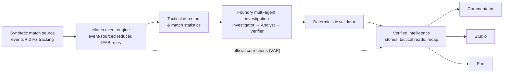

# BYLINE: Match Intelligence

**Football intelligence you can trust, written for whoever is watching.**

BYLINE follows a live football match event by event, detects the moments and tactical patterns that matter, has a team of AI agents investigate and verify the evidence, and turns the result into three different experiences: research for the **commentator**, approval-gated graphics for the **studio producer**, and an explainable second screen for the **fan**.

> **Synthetic data, fictional clubs.** Northbridge Athletic, Riverton City, their players, officials, stadiums and histories are invented. BYLINE is not connected to the Premier League, any broadcaster or any real data feed, and uses no real footage, crests or brands. The studio "programme" output is simulated; no broadcast hardware is connected.

Built for Microsoft's *Inside the Game: Premier League Developer Hackathon* (2026).

**Live demo:** _to be added at release_ · **Video (under 2 minutes):** _to be added at release_


## The problem

Live football produces thousands of events a match. Broadcasters and fans get raw numbers; what they need is to know **which moments matter and why**, with claims they can trust on air. Generic AI summaries are fast but unverifiable. BYLINE treats every published claim as something that must be traced back to match evidence.

## What makes it different

- **An evolving understanding of the match:** stories move from *watching* to *building* to *confirmed* as evidence accumulates, and are withdrawn when an official correction (VAR) changes the record.
- **Evidence-backed explanations:** every insight cites real event IDs; a deterministic validator blocks unsupported names, numbers, outcomes and betting language.
- **Tactical visualisation:** a guided 3D replay (Three.js, with an SVG fallback) shows what happened, what was measured, and, clearly labelled, what else was on.
- **Hypotheticals with limits:** *What If?* alternatives and an illustrative continuation are computed from the frozen tracking frame, labelled "not what happened", with no probabilities and no implied outcome.
- **Human in the loop:** nothing airs in the studio without a producer's approval; VAR holds and corrections withdraw graphics automatically.

## Three experiences, one engine

| Commentator | Studio | Fan |
|---|---|---|
| One live insight, developing stories, talking points with *Mark used* and *Pin*, the line-up as shirts, player and club files that lead with the one fact worth saying, quick tools (players, clubs, tactics, stats, records, fixtures, managers, decisions, search). | Live production rundown, preview and simulated programme monitors, four graphic formats (lower third, corner box, spotlight, full screen), template-driven broadcaster styles with per-field data provenance, VAR holds, take on/off air, pre-match/half-time/full-time packages. | Classic (just the match), Discover (moments explained) and Analyst (measurements first); pick a side by crest, follow a player, compare the teams, and play *What would you do?* on the real frozen frame. |

| | |
|---|---|
|  |  |
|  |  |

## Architecture



- **Ingest.** A seeded simulator produces three full 96-minute matches (about 2,600 events each plus tracking). Sessions stream them over server-sent events at 1–60x; seeking rebuilds state from the log, so replays are deterministic.
- **Interpret.** A strict event-sourced reducer enforces the laws of the game (provisional goals during VAR checks, no actions by dismissed players). Detectors find repeated-channel attacks, fast counters, overlaps, line-breaking passes, high turnovers and better passing options from events and tracking; restarts are never measured as open play.
- **Explain.** See the multi-agent workflow below; there is also a law-grounded "Why that decision?" explainer for official decisions.
- **Render and personalise.** One verified claim is written for each audience (commentator, studio, fan), with an optional Spanish variant.

Details: [architecture decisions](docs/architecture-decisions.md) · [API contract](docs/api-contract.md) · [evaluation](docs/evaluation/report.md) · [intelligence audit](docs/final-pass-report.md).

## How BYLINE uses Microsoft Foundry and multi-agent AI

BYLINE uses Microsoft Agent Framework to orchestrate three specialised AI agents powered by a GPT-4.1-mini model deployment in Microsoft Foundry.

The **Investigator** gathers and structures relevant match events, tracking measurements and contextual evidence. The **Analyst** transforms this evidence into a tactical explanation. The **Verifier** independently evaluates the explanation against the source data.

A conditional workflow allows claims to be revised when verification identifies problems. A separate deterministic validation layer checks evidence references, calculations and football-specific constraints before an insight can be published.

The hackathon demonstration uses recorded outputs from genuine Microsoft Foundry inference runs, with traceable response IDs, agent handoffs and verification decisions. The publicly accessible application operates in cache-only mode to control spending, while preserving the original agent execution records for inspection.

Agents execute within BYLINE's Python backend using Microsoft Agent Framework. They are not hosted in Foundry Agent Service.

Where to look: `apps/api/byline/agents/orchestrator.py` (the `WorkflowBuilder` graph and the three executors), `agents/tools.py` (bounded read-only tools), `agents/validator.py` (deterministic checks), `apps/api/recorded/` (the recorded runs with per-step response IDs, tokens and latency), `docs/ai-provenance.md`.

**Recorded, not live.** In the demo, every AI result is a stored record of a real run, shown with its trace ("Real Foundry run"). Cache misses fall back to clearly labelled deterministic summaries; they never trigger a model call. A persistent hard cap blocks calls even if cache-only were switched off.

## Microsoft and Azure technology used

| Technology | How BYLINE uses it |
|---|---|
| Microsoft Foundry | GPT-4.1-mini model deployment used for the agent runs (Entra ID authentication) |
| Microsoft Agent Framework (Python) | `WorkflowBuilder` graph, `Agent`s with function tools and middleware metering |
| Azure Container Apps | Target hosting for the public demo (single container, cache-only) |
| GitHub Actions | CI: tests, type checks, lint, secret scans, container build and smoke test, browser E2E and accessibility |

## Run it

**Container (what the public demo runs):**

```bash
docker build -t byline .
docker run -p 8000:8000 byline     # http://localhost:8000, cache-only, no credentials needed
```

**Development:** Python 3.12 and Node 22.

```bash
cd apps/api && python -m venv .venv && .venv/bin/pip install -e ".[dev]" -r requirements-ai.txt
BYLINE_AI_PROVIDER=foundry BYLINE_AI_CACHE_ONLY=true .venv/bin/python -m uvicorn byline.api.app:app --port 8000
cd apps/web && npm ci && npm run dev    # http://localhost:5173
```

## Tests and CI

`pytest` (backend, including security and no-model-call proofs), `ruff` and strict `mypy`; `vitest`, `tsc` and ESLint (web); Playwright browser E2E; an axe accessibility audit over 13 states at three viewports; secret scans of the tree, the full history and the built bundle. CI never calls a model, never deploys and needs no secrets ([.github/workflows/ci.yml](.github/workflows/ci.yml)).

## Security model

Read-only public demo: visitors get their own ephemeral replay session and cannot change match data, recorded AI evidence or configuration. Strict Content-Security-Policy and security headers, request-size limits, rate limits that ignore spoofed forwarding headers, no API docs in production, a non-root container. See [security audit](docs/security-audit.md).

## Known limitations

- Synthetic data only; a licensed live data feed would replace the simulator.
- The demo shows recorded Foundry runs, not live inference.
- Studio programme output is simulated; there is no broadcast integration.
- Tactical hypotheticals are geometric sketches from a frozen frame, not predictions.

## Licence and attribution

No licence has been chosen yet: until one is added, the source is visible but no rights to reuse it are granted. Third-party components keep their own licences; see [THIRD_PARTY.md](apps/web/THIRD_PARTY.md) and [licensing and data](docs/licensing-and-data.md). Fonts: Instrument Sans, Archivo, Manrope and Barlow Condensed (SIL Open Font License).
